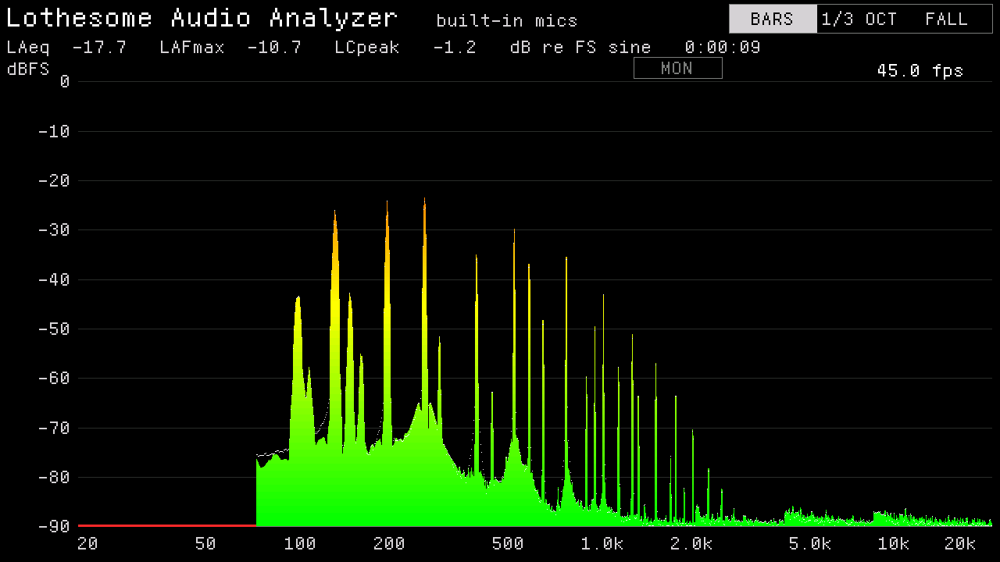

# Lothesome Audio Analyzer *for M5Tab5*

A live audio analyzer for the M5Stack Tab5: spectrum from 20 Hz to the
source's Nyquist, a 1/3-octave RTA, a waterfall, and a sound level meter.



## Building

Rev 2 Tabs (ST7121 panel) only. ESP-IDF 5.5 or later:

```
cd m5tab5
idf.py build flash monitor
```

The analyzer itself is an ELF that the firmware loads with esp_elf; the
build makes it in `build/elf/` and embeds it. Each release also
publishes it alone, for a launcher on the same
[feckless ABI](https://github.com/Sudrien/feckless-abi-for-m5tab5)
(the tag in `m5tab5/main/idf_component.yml`).

## Sources

The analyzer uses the first of these it finds, and names it at the top of
the screen:

1. **A USB microphone** on the USB-A port, plugged in directly (not
   through a hub). The label shows its sample rate when it isn't 48 kHz
   and its dynamic range from its bit depth: 98 dB for 16-bit, 146 dB
   for 24-bit.
2. **A headset on the 3.5 mm jack.** The jack senses a plug, not a
   microphone, so plain headphones give an empty spectrum.
3. **The two built-in microphones.**

The built-in microphones and the jack hear nothing below 80 Hz; that part
of the axis is marked with a red line at -90 dBFS.

**MON**, in the menu, sends the source to headphones on the jack or a USB
headset, at a fixed volume. It is off at power-up; while it is on, MON
shows beside the fps. A USB microphone is passed straight
through to the USB output: its own channels, so a stereo one stays
stereo, at 16 bits.

## Views

The gear, top right, opens the menu: the three views, **FAST/SLOW**,
**MON** and **LICENCES**. Tap the gear again, or anywhere off the menu,
to close it. The graph pauses while the menu is open; the meter keeps
measuring.

- **BARS** -- the spectrum, one bar per pixel column. Bass is finer but
  slower to respond: 2.9 Hz resolution over a third of a second at the
  bottom, 47 Hz over 21 ms at the top.
- **1/3 OCT** -- the 31 standard bands, 20 Hz to 20 kHz. Pink noise reads
  flat. **FAST/SLOW** picks 125 ms or 1 s averaging; use Slow for pink
  noise. The one in use shows beside the fps. A grey top band means the
  source's sample rate cuts it short.
- **FALL** -- the last ten seconds as a waterfall, newest at the top.

## The meter

Under the title:

- **LAeq** -- A-weighted average since the last reset
- **LAFmax** -- highest A-weighted Fast (125 ms) reading
- **LCpeak** -- highest C-weighted sample

**Hold a finger on the screen for half a second to reset.** A tap does
not, so a stray touch can't wipe a measurement; changing source does
reset. **CLIP** means the input hit full scale, so the readings are low.

Levels are dB relative to a full-scale sine, not dB SPL. Converting to
SPL needs a calibrated acoustic reference (see the calibration section
of the [original project](https://github.com/Sudrien/m5tab5_spectrum_analyzer)).

## Credits

A C port of
[m5tab5_spectrum_analyzer](https://github.com/Sudrien/m5tab5_spectrum_analyzer)
(kept in `original/`), built on
[feckless-drivers](https://github.com/Sudrien/feckless-drivers-for-m5tab5),
[feckless-graphics-handler](https://github.com/Sudrien/feckless-graphics-handler-for-m5tab5)
and [esp-dsp](https://components.espressif.com/components/espressif/esp-dsp).
How it works: `ARCHITECTURE.md`.

## Development

`make -C m5tab5/test` runs the host tests. `make -C m5tab5/test/render` draws each view
to a `.ppm` on a PC, and the menu and the licences page; it needs one
`idf.py build` first, for the font, and cmake.

## Licence

MIT. See `LICENSE`. The firmware also contains ESP-IDF, esp-dsp,
Espressif's LCD, touch and USB components, the feckless libraries and the
Ark Pixel font (OFL-1.1). **LICENCES** in the menu lists each, at the
version the build used, with its licence.
